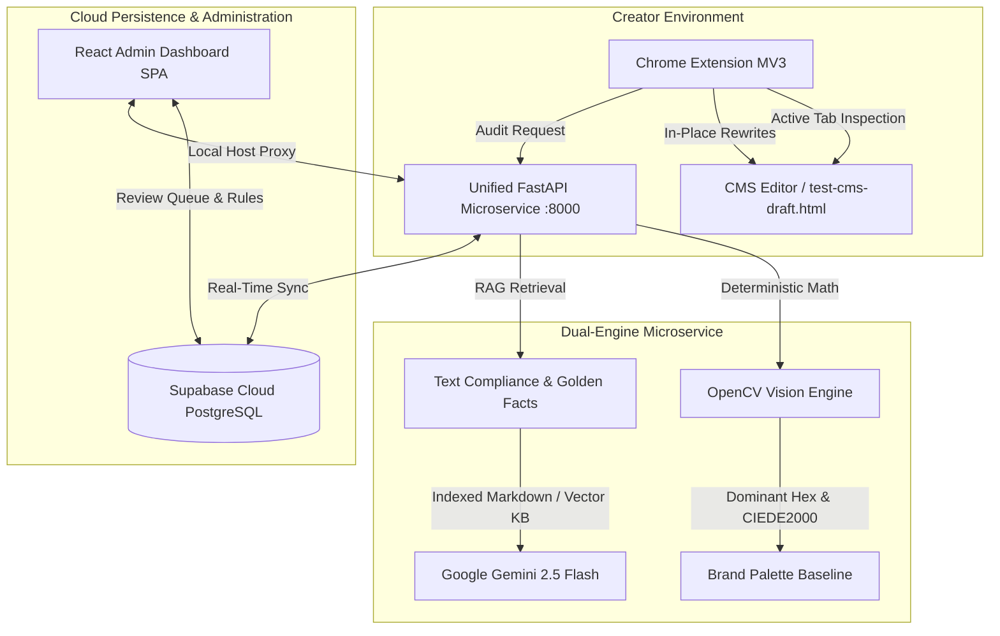

# Inkloom AI — Interactive Tutorial & Operations Sheet

> **The Definitive Step-by-Step Guide for Hackathon Judges, Evaluators, and Engineers.**  
> Learn how to launch, test, evaluate, and operate the Inkloom AI Brand Governance Platform in under 5 minutes.

---

## 📑 Table of Contents

1. [Platform Architecture at a Glance](#1-platform-architecture-at-a-glance)
2. [5-Minute Quickstart (Choose Your Run Mode)](#2-5-minute-quickstart-choose-your-run-mode)
   * [Mode A: Unified Python Runner (Recommended for Local Testing)](#mode-a-unified-python-runner-recommended-for-local-testing)
   * [Mode B: Single-Command Docker Compose (Production Parity)](#mode-b-single-command-docker-compose-production-parity)
   * [Mode C: Live Cloud Deployment (Vercel + Supabase)](#mode-c-live-cloud-deployment-vercel--supabase)
3. [Chrome Extension: In-Context CMS Auditing](#3-chrome-extension-in-context-cms-auditing)
4. [3 Core Demo Scenarios for Judges](#4-3-core-demo-scenarios-for-judges)
   * [Scenario 1: Factual Drift & Outdated Pricing Verification](#scenario-1-factual-drift--outdated-pricing-verification)
   * [Scenario 2: Prohibited Superlatives & SLA Claims](#scenario-2-prohibited-superlatives--sla-claims)
   * [Scenario 3: OpenCV Matrix Sampling & Color Palette Validation](#scenario-3-opencv-matrix-sampling--color-palette-validation)
5. [Admin Dashboard Deep Dive](#5-admin-dashboard-deep-dive)
   * [Creator Studio (3-Tier Dual-Engine Evaluation)](#creator-studio-3-tier-dual-engine-evaluation)
   * [Review Queue (Two-Way Escalation Pipeline)](#review-queue-two-way-escalation-pipeline)
   * [Brand Setup & Knowledge Base Management](#brand-setup--knowledge-base-management)
6. [API Endpoints & Interactive Documentation](#6-api-endpoints--interactive-documentation)
7. [Running the Automated Verification Suite](#7-running-the-automated-verification-suite)
8. [Troubleshooting & Frequently Asked Questions](#8-troubleshooting--frequently-asked-questions)

---

## 1. Platform Architecture at a Glance

Inkloom AI solves brand drift at the moment of creation through an integrated dual-engine architecture:



* **Deterministic Vision Engine (OpenCV)**: Zero-hallucination color-matrix extraction and perceptual $\Delta E_{00}$ color distance calculation. Runs in sub-milliseconds at \$0 API cost.
* **Factual Claims & Tone Engine (RAG + Gemini)**: Embeds enterprise Golden Facts (pricing, SLAs, disclaimers) to flag factual discrepancies and provide 1-click on-brand rewrites.
* **Unified Single Process**: React SPA, FastAPI backend, and Extension assets served simultaneously from one port (`8000`).

---

## 2. 5-Minute Quickstart (Choose Your Run Mode)

### Mode A: Unified Python Runner (Recommended for Local Testing)

Runs the compiled React frontend, FastAPI backend, and CMS simulator from a single Python command:

```powershell
# From the project root directory:
backend-api\.venv\Scripts\python.exe run.py
```

* **React Admin Dashboard**: [http://localhost:8000/](http://localhost:8000/) *(or [http://127.0.0.1:8000/](http://127.0.0.1:8000/))*
* **Interactive CMS Simulation Page**: [http://localhost:8000/test-draft](http://localhost:8000/test-draft)
* **Swagger API Documentation**: [http://localhost:8000/docs](http://localhost:8000/docs)
* **Health Check Endpoint**: [http://localhost:8000/health](http://localhost:8000/health)

---

### Mode B: Single-Command Docker Compose (Production Parity)

A multi-stage container bundling Node 20 build-time assets and Python 3.11 with system C-libraries:

```bash
# Build and launch in detached mode:
docker compose up -d --build
```

* Builds in under 60 seconds with `.dockerignore` context caching.
* Automatically includes production fallbacks for Supabase and Gemini credentials.
* **Healthcheck**: Automatic 20-second probe at `http://localhost:8000/health`.

To stop the container:
```bash
docker compose down
```

---

### Mode C: Live Cloud Deployment (Vercel + Supabase)

If reviewing via cloud links:

1. **Live Admin Dashboard URL**: `https://brand-governance-system.vercel.app`
2. **Cloud Database**: Hosted on AWS Tokyo (`ap-northeast-1`) via Supabase with active tables for `golden_facts`, `brand_rules`, `audit_events`, and `review_queue`.
3. **Resilience**: Features client-side Tier-3 evaluation engine fallback ensuring 100% demo uptime even if external APIs experience network latency.

---

## 3. Chrome Extension: In-Context CMS Auditing

Experience real-time, in-context governance inside any web-based CMS without switching browser tabs.

### Installation in 3 Steps:

1. Open Google Chrome and go to `chrome://extensions/`.
2. Toggle on **Developer mode** in the top-right corner.
3. Click **Load unpacked** and select the `extension/` folder in this repository:
   ```text
   C:\Brand governance folder\extension
   ```
4. Pin **Inkloom AI** to your Chrome toolbar.

---

## 4. 3 Core Demo Scenarios for Judges

Follow these three structured workflows to test the system end-to-end:

### Scenario 1: Factual Drift & Outdated Pricing Verification

1. Open [http://localhost:8000/test-draft](http://localhost:8000/test-draft) (or the standalone `test-cms-draft.html` file).
2. Notice the draft copy contains an outdated claim:
   > *"Try Inkloom AI today with our $29/mo starter tier for unlimited growth."*
3. Click the **Inkloom AI** Chrome Extension icon and click **"Audit Active Tab"**.
4. **Expected Result**:
   * The text `$29/mo` is highlighted with an in-page wavy underline.
   * Hovering displays: **"Contradicts verified Golden Facts: Pricing Matrix v2.4. Starter tier updated to $49/mo."**
   * Click **"1-Click Apply"** in the popup: The draft text in the page updates instantly to `$49/month`!

---

### Scenario 2: Prohibited Superlatives & SLA Claims

1. In the CMS editor, inspect the enterprise copy:
   > *"Inkloom guarantees 100% uptime and completely bug-free automation."*
2. Run the audit.
3. **Expected Result**:
   * Flagged as **Critical Violation**.
   * Citation: *Enterprise SLA Agreement v2026.1, Section 4.2*.
   * Suggested Rewrite: *"guaranteed 99.99% multi-region uptime"*.
   * Banned superlative *"completely bug-free"* flagged under Corporate Tone Guidelines.

---

### Scenario 3: OpenCV Matrix Sampling & Color Palette Validation

1. In the test CMS page, notice the banner image.
2. The vision engine extracts the dominant hex color from the pixel matrix using OpenCV and computes the perceptual CIE L\*a\*b\* CIEDE2000 distance ($\Delta E_{00}$) against approved brand `#4F46E5`.
3. **Expected Result**:
   * An off-brand banner (e.g. `#FF5733`) triggers a **Visual Violation** with mathematical distance reported.
   * On-brand images within tolerance ($\Delta E \le 35.0$) receive a green **Compliant** badge.

---

## 5. Admin Dashboard Deep Dive

Open [http://localhost:8000/](http://localhost:8000/) to access the centralized governance hub:

### Creator Studio (3-Tier Dual-Engine Evaluation)
* **Tier 1 (Vector DB + RAG)**: Queries Supabase pgvector embedding store for corporate facts.
* **Tier 2 (FastAPI Unified Backend)**: Evaluates copy and image URLs concurrently via `POST /api/check-content`.
* **Tier 3 (Client-Side Engine)**: In-browser deterministic rule fallback guaranteeing 100% demo availability.
* **1-Click Diff Application**: Click any suggestion to watch the live draft text update with visual diff highlights.

### Review Queue (Two-Way Escalation Pipeline)
* Escalate flagged drafts from the Chrome Extension or Creator Studio directly into the administrative queue.
* Reviewers can **Approve**, **Reject**, or request revisions with real-time Supabase state synchronization.

### Brand Setup & Knowledge Base Management
* Configure primary (`#4F46E5`) and secondary (`#06B6D4`) brand hex codes.
* Adjust color tolerance sliders ($\Delta E$ threshold).
* Upload and index Golden Facts markdown/CSV documents.

---

## 6. API Endpoints & Interactive Documentation

FastAPI provides interactive OpenAPI/Swagger documentation at [http://localhost:8000/docs](http://localhost:8000/docs):

| Method | Endpoint | Description |
| :--- | :--- | :--- |
| `GET` | `/health` | System health check and Gemini API status probe |
| `POST` | `/api/check-content` | Dual-engine evaluation (Text RAG + OpenCV Vision) |
| `GET` | `/api/auth/config` | Client-safe Supabase configuration |
| `POST` | `/api/reviews/escalate` | Escalate a non-compliant draft to the human review queue |
| `GET` | `/api/reviews` | Retrieve all pending review queue items |
| `POST` | `/api/reviews/{id}/action` | Approve or reject a review queue item |
| `GET` | `/test-draft` | In-context CMS simulation sandbox |
| `GET` | `/inkloom-extension.zip` | Download pre-packaged Chrome extension ZIP |

---

## 7. Running the Automated Verification Suite

Run the automated pytest test suite covering the entire backend pipeline:

```powershell
cd backend-api
.venv\Scripts\python.exe -m pytest -v
```

### Verified Coverage:
* `test_health_endpoint`: Operational status probe.
* `test_root_endpoint`: Unified SPA routing.
* `test_content_check_outdated_pricing`: Flags `$29` and verifies `$49` rewrite.
* `test_content_check_compliant_text`: Verifies 100% compliant scoring.
* `test_vision_rgb_to_hex_and_distance`: Tests mathematical RGB-to-hex and Euclidean distance.

---

## 8. Troubleshooting & Frequently Asked Questions

#### Q: Why does `http://0.0.0.0:8000` show an error in Google Chrome?
* **A**: `0.0.0.0` is an operating system bind address meaning *"listen on all interfaces"*. Modern Chromium browsers block navigating to `0.0.0.0` for security. **Always navigate to [http://localhost:8000](http://localhost:8000) or [http://127.0.0.1:8000](http://127.0.0.1:8000).**

#### Q: What if port 8000 is occupied by another process on Windows?
* **A**: Run the following in PowerShell to identify and terminate any conflicting process:
  ```powershell
  Get-NetTCPConnection -LocalPort 8000 | Select-Object LocalAddress, OwningProcess
  Stop-Process -Id <PID> -Force
  ```

#### Q: How does the Chrome extension connect to the backend?
* **A**: The extension background worker (`service_worker.js`) defaults to `http://localhost:8000`. When using cloud deployments, update the `BACKEND_URL` variable in `popup.js` and `service_worker.js`.

---

*Authored by Team A4 — Hackathon Submission.*

